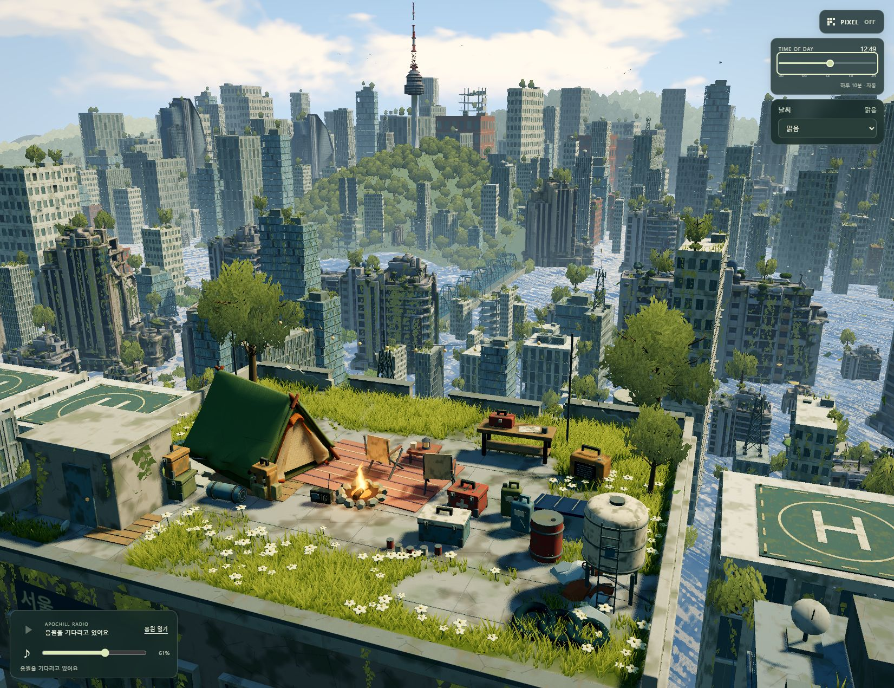

# Apochill Kit · 아포칠

A browser-based rooftop diorama of a nature-reclaimed Seoul, built with **Three.js + Vite** and **Tripo-generated 3D assets**.

[](https://github.com/jujinghks3-svg/apochill-kit/actions/workflows/verify.yml)

서울의 옥상 생존 캠프와 자연이 되찾은 도시를 탐색하는 웹 프로젝트입니다. Tripo에서 생성한 모델, 웹용 최적화 에셋, 씬 소스, 3D 에셋 갤러리를 함께 공유합니다.



## Quick start / 실행

Install Node.js **24 LTS** (minimum supported: 22.12), then run:

```sh
npm ci
npm run dev
```

Open <http://127.0.0.1:5174/> for the scene, or <http://127.0.0.1:5174/gallery.html> for the Tripo asset gallery. Keep the terminal open; press Ctrl+C to stop.

GitHub에서 **Code → Download ZIP**으로 내려받아 압축을 풀고, 해당 폴더에서 위 명령을 실행하면 됩니다. HTML 파일을 직접 더블클릭하는 대신 개발 서버 주소로 접속하세요.

**No Tripo account, API key, or paid generation request is needed to run this kit.** All included models are already generated. npm downloads the dependencies; models, textures, fonts and music are served locally.

## Included

- Rooftop camp and stylized Seoul city scene, day/night cycle, weather, vegetation, water and lighting.
- Tripo buildings, survival props, character and dog assets in GLB format.
- Asset gallery with orbit controls, model variants and GLB downloads.
- Local music player and included project music.

The layout is an artistic interpretation, not a geographically accurate reconstruction. Windows foreground-app detection is disabled in this standalone kit. Generation scripts, raw API responses, credentials, working logs, Blender experiments and reference images are not included.

## Build

```sh
npm run build
npm run preview
```

## Verify your download / 다운로드 검증

```sh
npm run verify
```

This checks every listed file against `kit-manifest.json` (SHA-256 and size), validates the gallery's asset references, checks that GLB models include their resources, and checks music files. `npm run build` separately verifies that the source compiles. The GitHub **Actions → Verify kit** workflow runs installation, file verification and build on each push. A green check means these checks passed; it does not guarantee that every visual feature is bug-free.

GitHub의 **Actions → Verify kit**에서 초록색 체크를 확인하세요. 직접 내려받은 뒤 `npm ci`, `npm run verify`, `npm run build`를 실행하면 파일 누락·변경과 빌드 가능 여부를 확인할 수 있습니다. 화면 동작은 `npm run dev`로 씬과 갤러리를 열어 별도로 확인하세요.

Preview: <http://127.0.0.1:4173/>. The production files are in `dist/`. The build includes both `index.html` and `gallery.html`. Draco decoders are copied from Three.js automatically before development and builds.

The current app expects hosting at the domain root. Hosting under a subdirectory, such as a GitHub Pages project path, requires adapting its root-relative links. Publishing this repository does not automatically publish a running website.

## Project map

| Path | Contents |
| --- | --- |
| `src/bootstrap.js`, `src/main.js` | Scene startup and rendering |
| `src/seoul-scene.js` | City composition |
| `src/model-gallery.js` | Interactive Tripo gallery |
| `assets/web/buildings/` | Building models and LOD variants |
| `assets/web/props/`, `assets/web/companions/` | Camp props and characters |
| `assets/web/gallery/catalog.json` | Model paths, previews and variant metadata |
| `assets/web/textures/`, `assets/web/audio/` | Textures and music |

## Credits and reuse

3D generation: **Tripo**. Runtime: **Three.js**. Build tooling: **Vite**. Font: **Galmuri**, with its SIL Open Font License included at `assets/web/fonts/OFL-Galmuri.md`.

This repository is publicly shared for viewing and evaluation. No general open-source or asset-reuse license has been selected for the project's original code, models, textures or music. Contact the repository owner before redistributing or commercially reusing those materials. Third-party components retain their own licenses.

이 저장소는 공개 열람·검토를 위한 공유본입니다. 프로젝트 고유 코드·모델·텍스처·음악의 재배포 및 상업적 재사용 조건은 저장소 소유자에게 문의해 주세요.
